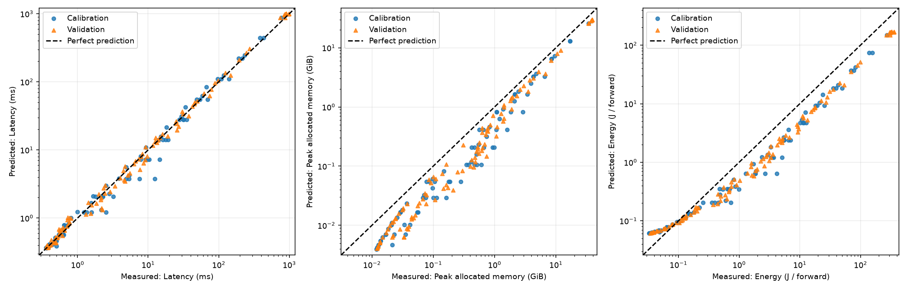
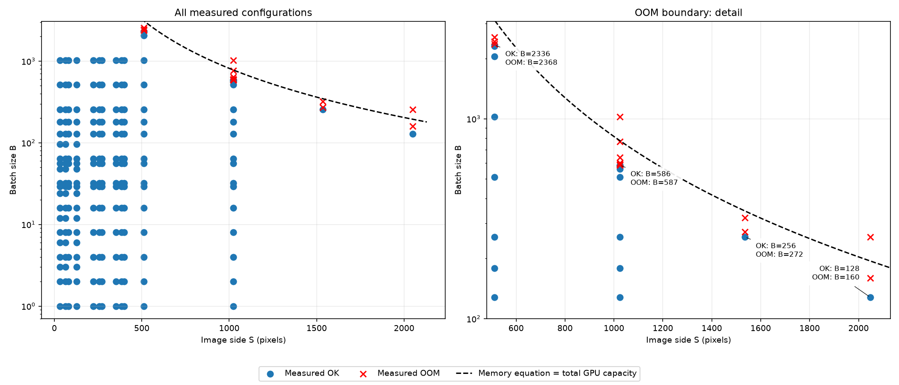

# Аналитическая модель небольшой CNN

Сеть из задания реализована в `models.py`. Рукописные выводы: [hw1_handwritten.pdf](hw1_handwritten.pdf).
Формулы находятся в `equations.py`, измерения — в `results/measurements.csv`,
параметры калибровки — в `results/theta.json`.

**Окружение.** NVIDIA A100-SXM4-40GB (ёмкость по данным PyTorch — 39,494 GiB), Python 3.13.15,
PyTorch 2.14.0+cu130, CUDA 13.0, cuDNN 9.24.0. Версии остальных библиотек закреплены
в `requirements.txt`. A100 мощнее GPU, указанной в задании; для исследования OOM
сетка расширена. Полные сведения о запуске: `results/measurements.meta.json`.

**Запуск из корня проекта** на NVIDIA GPU с совместимым драйвером:

```bash
python -m venv .venv
source .venv/bin/activate
python -m pip install torch==2.14.0 --index-url https://download.pytorch.org/whl/cu130
python -m pip install -r requirements.txt
python measure.py
python calibrate.py
python plot.py
```

`measure.py` продолжает существующий CSV, пропуская готовые точки, и проверяет
совпадение GPU, версий и параметров измерений. Для полностью нового эксперимента
нужно предварительно перенести старые `measurements.csv` и `measurements.meta.json`
в другое место. Калибровка и графики пересоздают свои выходные файлы.

**Сетка и измерения.** Базовые S: 32, 64, 128, 224, 256, 384, 512, **1024**;
базовые B: 1, 2, 4, 8, 16, 32, 64, 128, 256, **512, 1024**. Сохранена исходная
сетка задания; добавлены большие значения для OOM. Ещё 4 S и 3 B выбираются
случайно в исходных диапазонах при seed=42. Эта часть содержит 168 конфигураций.
Дополнительно заданы 41 проверочная точка: 18 с S=32, 64, 128 и
B=3, 6, 12, 24, 48, 96 для исследования overhead; ещё 23 около OOM
при S=512, 1024, 1536, 2048. Это отдельные пары, а не новая декартова сетка.
Всего 209 конфигураций; списки дополнительных точек находятся в `measure.py`
и `results/measurements.meta.json`.
Калибровка использует успешные базовые точки; остальные имеют `is_validation=1`
и используются только для проверки.

Входы случайные, FP32; сеть работает в `eval()` и `inference_mode()`.
`cudnn.benchmark=False`, оба флага TF32 выключены. После 10 прогревочных проходов
измеряется пик `max_memory_allocated()`, latency — медиана 30 проходов с
синхронизацией CUDA. Энергия всей GPU — интеграл мощности NVML за не менее 3 секунд,
делённый на число проходов; перед ним выполняется дополнительный секундный прогрев.
Энергия включает потребление в паузах между проходами и при синхронизации.
Настоящий `torch.cuda.OutOfMemoryError` записывается как `OOM`; время и энергия
неудачного прохода не подменяются прогнозом.

**Предположения формул.**

- **FLOPs:** 1 MAC = 2 операции, bias — одно сложение; сравнения ReLU и MaxPool
  также считаются операциями. Для MaxPool приняты 8 сравнений на выход,
  краевые окна не уточняются. Итог: `F = 17751·B·S² + 313956·B`.
- **Память:** учитываются веса, исходный вход и одновременно живущие вход/выход
  слоя; ReLU работает на месте, промежуточные активации освобождаются.
  В рукописной оценке не учитываются индексы pooling, workspace библиотек и
  округление выделений. Итог: `M = 4161296 + 52·B·S²` байт.
- **Трафик:** каждый слой читает вход и веса один раз и записывает выход;
  ReLU читает и записывает тот же буфер. Кеши, повторные чтения, индексы pooling
  и workspace не моделируются. Сумма: `Q = 364·B·S² + 8592·B + 4161296` байт.
- **Latency:** слои выполняются последовательно;
  `T = T0 + Σ max(Fi/P, Qi/W)` секунд. Вычисления и перенос данных внутри слоя
  условно перекрываются; общий overhead T0 и эффективные P, W постоянны для сетки.
- **Энергия:** `E = mean_power_w · T` джоулей; средняя мощность считается
  постоянной. Калибровка минимизирует квадраты относительных ошибок.

**Результаты и ограничения.** Из 209 точек 195 завершились успешно, 14 получили
OOM. Наблюдённые пары около границы:

| S | Наибольший успешный B | Наименьший B с OOM |
|---:|---:|---:|
| 512 | 2336 | 2368 |
| 1024 | **586** | **587** |
| 1536 | 256 | 272 |
| 2048 | 128 | 160 |

При S=1024, B=586 измерены пик 38,926 GiB, latency 902,90 ms и энергия 323,62 J.
Это граница в данном эксперименте, зависящая также от свободной памяти и workspace.
Исходная формула предсказывает вместимость для 12 из 14 фактических OOM-точек.
Например, для S=1024, B=587 она даёт всего 29,812 GiB. Следовательно, одного
сравнения этой оценки с ёмкостью GPU недостаточно.

Калибровка выполнена по прежним 87 успешным базовым точкам, проверка — по 108 другим.
Дополнительные точки не изменили fitted параметры. Проверка теперь включает
как интерполяцию внутри исходного диапазона, так и большие входы вне него.
Средняя абсолютная относительная ошибка (MAPE) на проверочных точках:

| Величина | MAPE |
|---|---:|
| Latency | 11,46% |
| Memory | 51,32% |
| Energy | 43,61% |

Получены T0=348,39 μs, P=21,43 TFLOP/s, W=293,03 GB/s и средняя мощность
168,14 W. Формулы в коде сохранены в соответствии с рукописным выводом.

На S=32 при росте B от 1 до 24 время меняется лишь с 0,364 до 0,402 ms,
хотя число операций увеличивается в 24 раза: это согласуется с доминированием
overhead запуска. При увеличении batch эффективная производительность растёт;
например, на S=1024 при B=256 и 512 она составляет около 12,4 TFLOP/s,
а при B=586 — 12,1 TFLOP/s. Наблюдается насыщение, но его причина не определяется
одним измерением времени.

OOM означает предел ёмкости, а memory-bound — ограничение скорости передачи
данных. Это разные границы. Переход всей сети в чистый compute-bound не подтверждён:
на S=1024, B=586 модель относит 0,03% времени к overhead, 40,82% к вычислительным
ветвям и 59,15% к ветвям памяти. Conv2, Conv3, Conv5 и Conv6 при больших задачах
попадают в вычислительную ветвь модели, а часть других слоёв остаётся в ветви памяти.

Формула памяти систематически занижает измерения. MaxPool в PyTorch временно
создаёт int64-индексы, добавляя `16·B·S²` байт. После прогрева также остаётся
workspace 8,125 MiB; свёртки используют зависящие от формы временные буферы.
Например, при S=128, B=128 дополнительный workspace Conv5 составляет 544 MiB.
Поэтому одинаковое произведение B·S² не гарантирует одинаковый пик памяти,
а сравнение M с полной ёмкостью GPU даёт лишь приближённую границу OOM.

Энергетическая модель не учитывает изменение мощности с загрузкой GPU.
Это объясняет значительную часть её ошибки. Полезно рассматривать эти расхождения
как границы применимости допущений, а не как точные аппаратные характеристики.

**Графики.** Синие точки — калибровка, оранжевые — проверка; линии — прогнозы.
Красный крест на графиках по batch обозначает OOM и размещён у верхней границы
панели без численного значения по Y. На панелях памяти около OOM пунктиром
показана полная ёмкость GPU. `oom.png` содержит общую сетку и увеличенный участок
около границы; линия на нём — прогноз исходной формулы, а не измеренный предел.




Графики по S и B: [latency](results/figures/latency.png),
[memory](results/figures/memory.png), [energy](results/figures/energy.png).
[Измеренная latency и эффективная пропускная способность](results/figures/regimes.png).
Пропускная способность вычисляется как аналитические FLOPs, делённые на измеренное
время. Численное разложение исходной latency-модели сохранено в `results/regimes.csv`;
оно не является результатом аппаратного профилирования.
